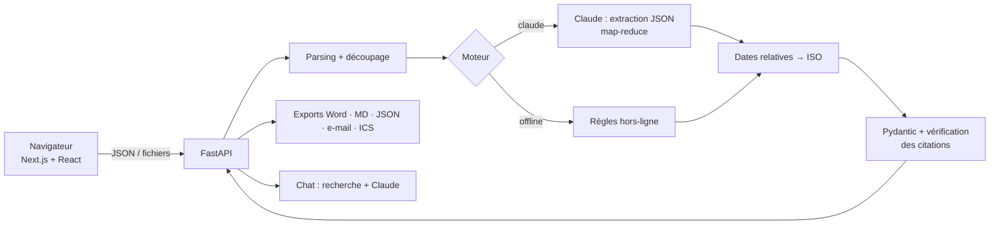

<div align="center">

# 🎯 MeetMind

### L'assistant IA qui transforme une réunion en décisions et en actions
**Next.js · FastAPI · Claude · Python NLP**

*Transcription → résumé structuré → décisions → actions (qui, quoi, quand) → exports.*
*Chaque élément extrait est relié à sa source dans la transcription.*

**Auteure : ERRACHDI Chaimae**

</div>

---

## ✨ Points forts
| | |
|---|---|
| 🧱 **Sortie structurée** | JSON validé par Pydantic : décisions, actions, responsables, échéances, priorités, questions ouvertes. |
| 🔗 **Traçabilité** | Chaque élément cite l'extrait exact ; le code **vérifie** la citation et retrouve le segment source (surlignage dans l'interface). |
| 🚫 **Anti-invention** | `null` si l'information n'est pas dite + contrôle automatique + taux de fidélité affiché. |
| 📅 **Dates réelles** | « vendredi », « la semaine prochaine » → date ISO, calculée par du code testé (pas par le LLM). |
| 📚 **Longues réunions** | Map-reduce : découpage en blocs, fusion, dédoublonnage. |
| 🔌 **Deux moteurs** | **Claude** (clé côté serveur) ou **règles hors-ligne** (sans clé, 100 % local, baseline). |
| 📤 **Exports** | Word, Markdown, JSON, e-mail de suivi, calendrier `.ics`. |
| 💬 **Chat avec la réunion** | Questions-réponses avec extraits sources. |

## 🧰 Stack
- **Frontend** : Next.js 14 (App Router) · React 18 · TypeScript · Tailwind CSS · lucide-react
- **Backend** : FastAPI · Uvicorn · Pydantic 2
- **NLP / IA** : Claude Sonnet 5.5 (SDK `anthropic`) · extracteur à règles · rapidfuzz · module de dates maison
- **Export** : python-docx · iCalendar · Markdown · JSON
- **Audio (optionnel)** : faster-whisper · pyannote.audio
- **Qualité** : pytest (56 tests) · ESLint · TypeScript strict · Docker Compose

## 🚀 Démarrage rapide
**Prérequis** : Python 3.11+, Node.js 20+.

```bash
# 1) Backend (terminal 1)
python -m venv .venv && source .venv/bin/activate        # Windows : .venv\Scripts\activate
pip install -r requirements.txt
export ANTHROPIC_API_KEY=sk-ant-...                       # facultatif (Windows PowerShell : $env:ANTHROPIC_API_KEY="...")
uvicorn api.main:app --reload --port 8000                 # docs interactives : http://localhost:8000/docs

# 2) Frontend (terminal 2)
cd frontend
cp .env.example .env.local
npm install
npm run dev                                               # http://localhost:3000
```
Ouvrez **http://localhost:3000** → « Charger l'exemple ». Sans clé API, le moteur **Hors-ligne** fonctionne.
Avec Docker : `docker compose up --build` (API :8000, web :3000).

## 🏗️ Architecture


```
meetmind/
├── api/            FastAPI (main.py, schemas.py)
├── core/           Cœur NLP réutilisé par l'API et la CLI
├── frontend/       Next.js (app/, components/, lib/)
├── prompts/        extraction.md · merge.md · qa.md
├── data/           samples/ + reference/
├── scripts/        run_cli.py · evaluate.py
├── tests/          56 tests pytest (cœur + API)
├── docs/           Guide d'étapes, évaluation, soutenance
└── Dockerfile · docker-compose.yml · Makefile
```

## 🔌 API
| Méthode | Route | Rôle |
|---|---|---|
| GET | `/api/health` | État, disponibilité de Claude et de l'audio |
| GET | `/api/sample` | Réunion d'exemple |
| POST | `/api/analyze` | `{text, filename, mode, meeting_date}` → rapport + segments |
| POST | `/api/transcribe` | Audio → texte (si faster-whisper installé) |
| POST | `/api/chat` | `{question, segments, mode}` → réponse + extraits |
| POST | `/api/export/{docx,md,json,ics}` | Rapport → fichier |
| POST | `/api/export/email` | Rapport → `{subject, body}` |

## ✅ Commandes
```bash
make test        # 56 tests backend
make check-web   # typecheck + lint + build du frontend
make demo        # CLI sur l'exemple
make eval        # évaluation P/R/F1
```

## ⚠️ Ce qui est vérifié, et ce qui ne l'est pas
**Vérifié** : 56 tests pytest ; typecheck, lint et build du frontend ; appels HTTP réels (API, CORS, page servie).
**Non vérifié** : le rendu et les interactions dans un navigateur (à faire : `docs/GUIDE_ETAPES.md`, étape 3) ; le mode Claude avec une vraie clé (testé avec un client simulé) ; l'audio (Whisper/pyannote) ; la construction des images Docker.
Le score 1,00 du moteur à règles sur l'exemple n'est **pas** représentatif : constituez 10 à 15 réunions annotées (`docs/EVALUATION.md`).

## 🔒 Confidentialité
Consentement des participants avant tout enregistrement. En mode Claude, seul le texte de la transcription est envoyé à l'API ; la clé reste sur le serveur et n'est jamais exposée au navigateur.
